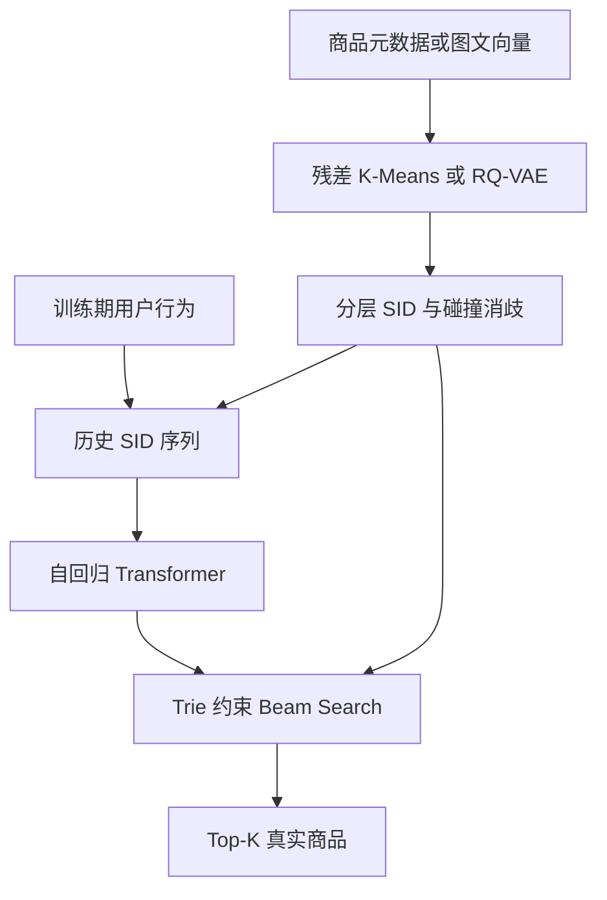

# GenRec Arena · 生成式推荐实验项目

从比赛任务出发，构建可训练、可验证、可对比的 **Semantic ID 自回归推荐**。

**已实现完整的单机实验闭环；已运行合成数据端到端训练与自动化测试。未提交比赛、未取得官方榜单成绩，尚未在真实比赛全量数据上验证效果。**

## 项目定位

| 参考 | 借鉴的部分 | 本项目实现与边界 |
|---|---|---|
| 腾讯广告算法大赛 2025 | 多模态商品表示、序列建模、生成式推荐 | 支持预计算多模态 embedding 拼接、RQ-VAE、SID 生成；不是官方训练/评测协议复刻，不直接读取腾讯原始 parquet |
| Kaggle H&M Personalized Fashion Recommendations | 购买历史 → 下一时间窗口商品列表；MAP@12 | 原始 transactions CSV 适配、articles 元数据、时间窗口评估、submission.csv 导出 |
| 阿里天池淘宝用户行为数据 | 点击/购买/收藏/加购等行为 | UserBehavior.csv 流式转换与用户级采样；一次选择一种事件，不冒称多行为联合模型 |
| TIGER | 语义 ID、自回归检索 | 独立实现 decoder-only Transformer + Trie beam search，不是论文数值复现 |

核心问题：**商品语义压缩能否在相同数据、候选集、评估协议下，改善推荐质量与推理成本？**

## 模型路径



- 三种 tokenizer：残差 K-Means、可训练 RQ-VAE、随机码消融。
- SID 各层独立 token 区间，固定长度进制后缀保证训练目录内商品唯一可解码。
- Teacher forcing 只对目标商品 SID 计算交叉熵，历史和 padding 不参与 loss。
- Trie 禁止不存在的 SID 路径。先做完整 softmax，再限制有效分支，保留原模型概率。
- 基线：Popularity、稀疏 ItemKNN、item-ID 因果 Transformer（SASRec-inspired，并非严格 SASRec 复现）。
- 训练：梯度裁剪、最佳验证 checkpoint、epoch 边界断点续训、配置/数据哈希校验。
- 评测：Recall、Hit、NDCG、MAP@K、目录覆盖率、单请求 p50/p95 延迟、冷用户/冷目标分组。
- 推理：命令行推荐、H&M 格式导出；没有对外服务部署或自动提交比赛。

## 5 分钟上手

Python 3.10+。建议使用独立环境。

```bash
git clone https://github.com/WRF2004/genrec-arena.git
cd genrec-arena
python -m venv .venv
source .venv/bin/activate
# CPU；服务器使用与你环境匹配的官方 CUDA 版 torch
pip install torch --index-url https://download.pytorch.org/whl/cpu
pip install -e '.[dev]'
pytest -q
bash scripts/smoke.sh
```

Windows 使用 WSL 或逐条执行 `scripts/smoke.sh` 中的 Python 命令。
`smoke.sh` 默认训练两个模型各 5 个 epoch；耗时取决于 CPU。脚本不覆盖已有训练目录，重跑请换目录或使用 `--resume`。

```bash
python -m genrec.cli recommend --data data/demo --run runs/demo-gen \
  --history i0000,i0006,i0012 --k 12 --beam 32
# 冷启动：省略 --history
```

输出目录 `runs/demo-gen/`：

| 文件 | 说明 |
|---|---|
| `best.pt` / `last.pt` | 最佳验证模型 / 完整 epoch 续训状态 |
| `config.json` / `environment.json` | 超参、环境、数据指纹 |
| `sid_diagnostics.json` | 语义碰撞率、最大桶、每层使用率/困惑度 |
| `train_log.json` | 每轮训练 loss、验证指标、耗时 |
| `test_metrics.json` | 独立测试结果 |
| `test_predictions.json` | 逐用户预测，可用于误差分析与配对 bootstrap |

只加载自己信任的 `.pt`：训练 checkpoint 包含优化器和 RNG 状态，使用 PyTorch pickle 加载。

## 真实数据实验

详细命令见 [数据手册](docs/DATA.md)，原理与评测见 [实验设计](docs/DESIGN.md)。

推荐先跑 H&M 的 **1% 用户子集**（每个被选用户保留完整历史），再逐步扩大。不要先处理全量亿级日志。

```bash
python -m genrec.cli convert --kind hm \
  --input data/raw/transactions_train.csv --output data/hm.csv --fraction 0.01
python -m genrec.cli prepare --input data/hm.csv --output data/hm \
  --train-end 2020-09-08 --val-end 2020-09-15 \
  --metadata data/raw/articles.csv --max-history 30 --feature-dim 128
python -m genrec.cli baselines --data data/hm --output runs/hm-baselines.json
python -m genrec.cli train --data data/hm --run runs/hm-gen \
  --config configs/hm.json --device cuda
python -m genrec.cli evaluate --data data/hm --run runs/hm-gen --device cuda
python -m genrec.cli train --data data/hm --run runs/hm-seq \
  --config configs/hm.json --mode sequence --device cuda
python -m genrec.cli evaluate --data data/hm --run runs/hm-seq --device cuda
```

验证集决定最佳 epoch，测试集只做最终报告。默认选模指标是 NDCG@K；H&M 若要专门优化 MAP，需在实验前固定选模规则并修改 `engine.py` 中的 `score`，不能看完测试结果再挑规则。

续训：增加配置中的 `epochs`，加 `--resume`，其余配置和数据不变。

```bash
python -m genrec.cli train --data data/hm --run runs/hm-gen \
  --config configs/hm.json --device cuda --resume
python scripts/ablate.py --data data/hm --config configs/hm.json \
  --output runs/hm-ablations --device cuda
```

## 目录

```text
src/genrec/data.py       转换、用户采样、时间切分、特征哈希
src/genrec/tokenizer.py  残差量化、RQ-VAE、SID 消歧、Trie
src/genrec/models.py     因果 Transformer
src/genrec/engine.py     训练、恢复、评测、推理
src/genrec/baselines.py  Popularity / ItemKNN
src/genrec/metrics.py    多目标排名指标
src/genrec/cli.py        统一命令行与 H&M 导出
scripts/                演示、消融、向量导入、显著性比较
configs/                CPU 演示和真实数据起点配置
reports/                实际执行记录（合成数据）
docs/                   数据、原理、实验路线、面试讲解
```

## 重要边界

1. 代码完整不等于模型已取得业务收益。当前报告仅证明训练/评测闭环可运行。
2. 默认元数据采用 feature hashing，是轻量内容表示；不是预训练语言模型或图像编码器。可导入真实图文 embedding，见数据手册。
3. 当前目录冻结在训练期，未见商品不可推荐但保留在指标分母；没有声称解决 item cold-start。
4. 大规模性能尚未优化：样本驻内存、量化距离张量随商品数增长、ItemKNN 构建可能较慢、解码未实现 KV cache、逐用户推理。未实现 DDP/AMP/FlashAttention/在线服务。
5. H&M 同日交易没有可靠的日内顺序：训练目标只能看到更早日期的历史，避免伪造先后关系。
6. H&M 官方 MAP@12 与本项目 MAP 公式一致，但冻结候选集、抽样规模、时间切分不同，本项目指标不是官方 leaderboard 分数。

## 下一步做出可写进简历的成果

按 [实验路线](docs/EXPERIMENTS.md) 跑真实数据 3 个种子，保存训练预算、质量/延迟、消融和失败案例。只有实测后才写“提升 X%”。可以先写“实现了基于 RQ-VAE 与约束解码的生成式推荐实验框架”，不能写比赛名次或未验证的提升。

## 来源与许可

研究与数据来源链接见 [REFERENCES](docs/REFERENCES.md)。本仓库代码独立实现，MIT；数据、模型、比赛规则遵循各自许可。仓库不包含受比赛条款限制的原始数据、账号凭证或真实用户日志。
